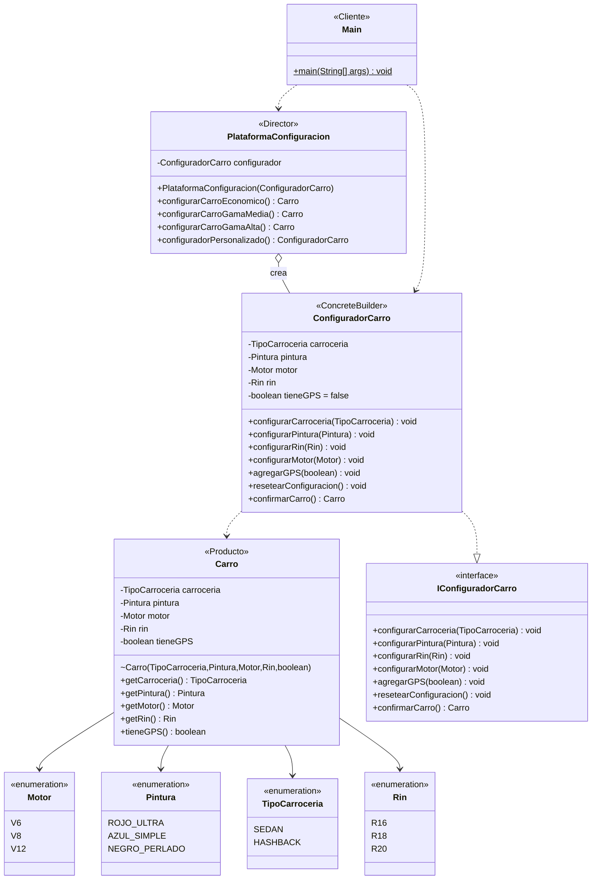

# Patrón Builder: configurador de carro

Este es un proyecto básico en Java para practicar el patrón Builder. La idea es configurar algunas características del carro (Como si estuviéramos en una página web configurando un carro que queremos comprar),escogiendo el motor, la pintura, la carrocería, los rines y si tiene GPS.

También hay tres configuraciones ya definidas: económico, gama media y gama alta. Además, se puede crear un carro personalizado.

## Contenido del proyecto

- **Carro.java:** representa el carro y guarda sus características. Sus atributos son privados y finales, por lo que no se pueden cambiar después de crear el objeto. Los valores se consultan por medio de getters.
- **IConfiguradorCarro.java:** interfaz con los métodos necesarios para configurar un carro.
- **ConfiguradorCarro.java:** implementa la interfaz anterior. Guarda las opciones elegidas y crea el carro con el método `confirmarCarro()`. También permite borrar la configuración con `resetearConfiguracion()`.
- **PlataformaConfiguracion.java:** usa el configurador para crear los carros económico, de gama media y de gama alta. También entrega un configurador para hacer un carro personalizado.
- **Main.java:** contiene un ejemplo de uso. Crea los diferentes carros y muestra sus características por consola.

## Idea principal

Primero se escogen las características en el configurador. Después, `confirmarCarro()` crea el objeto `Carro` con esos valores. Así se separa la configuración del carro de la clase que representa el carro.

Para probar el proyecto, se puede abrir en IntelliJ IDEA y ejecutar la clase `Main`.

## Diagrama de clase

